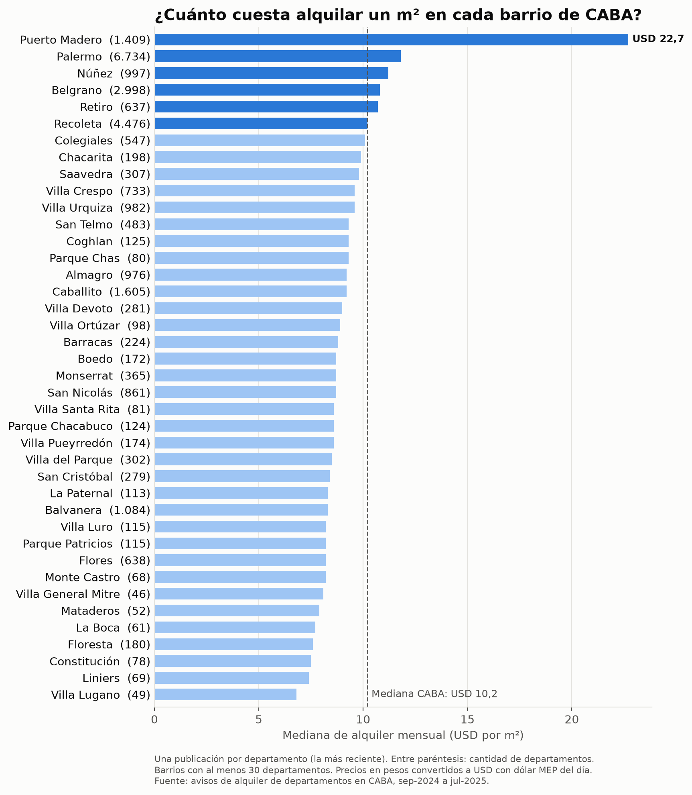
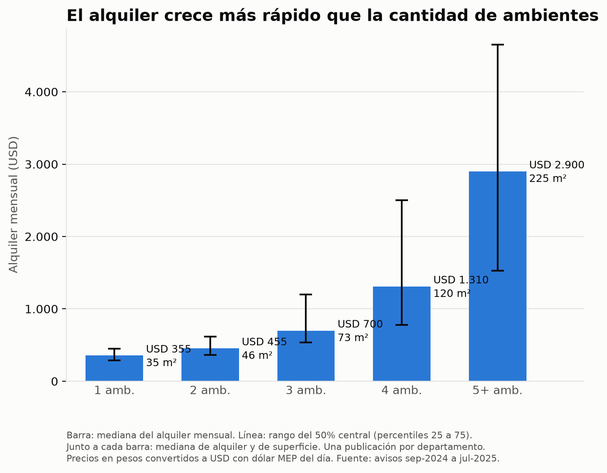
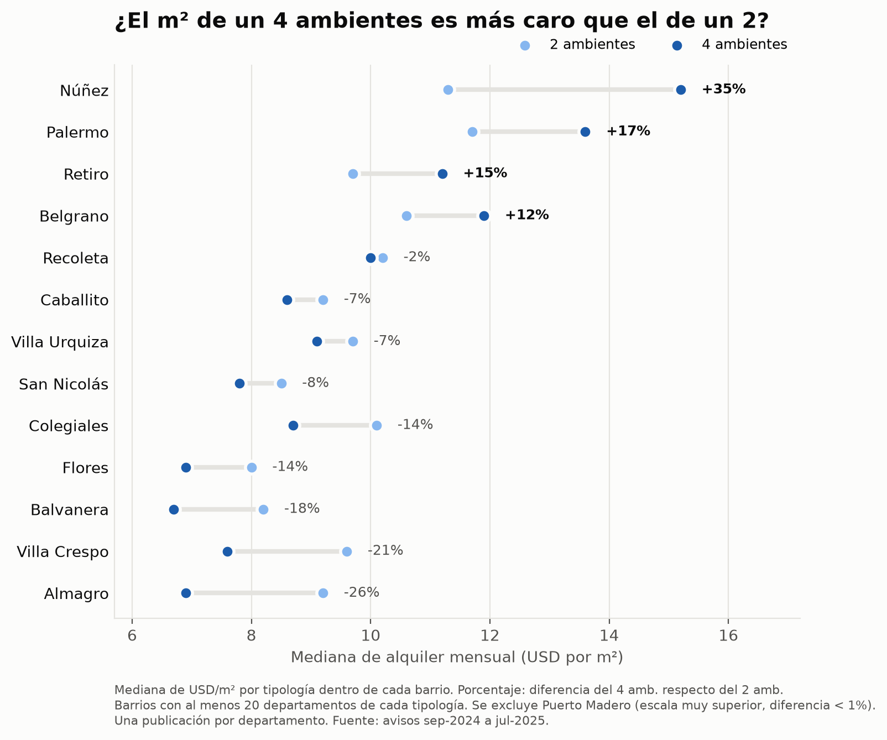
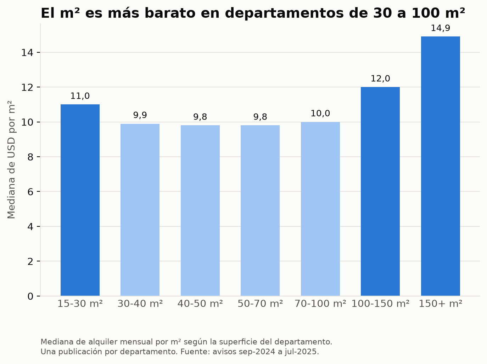
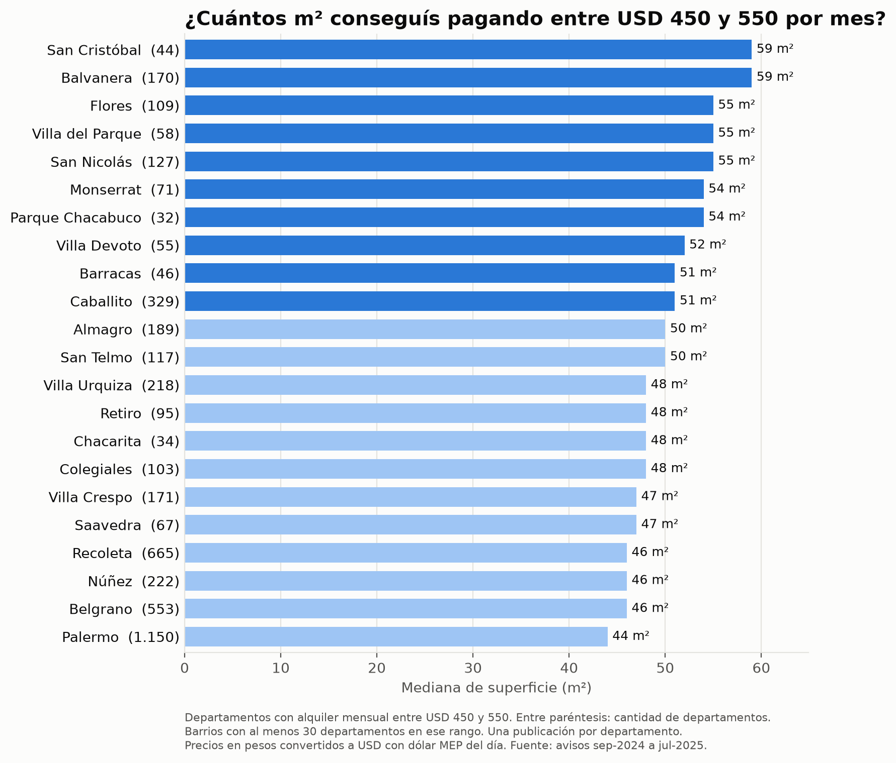
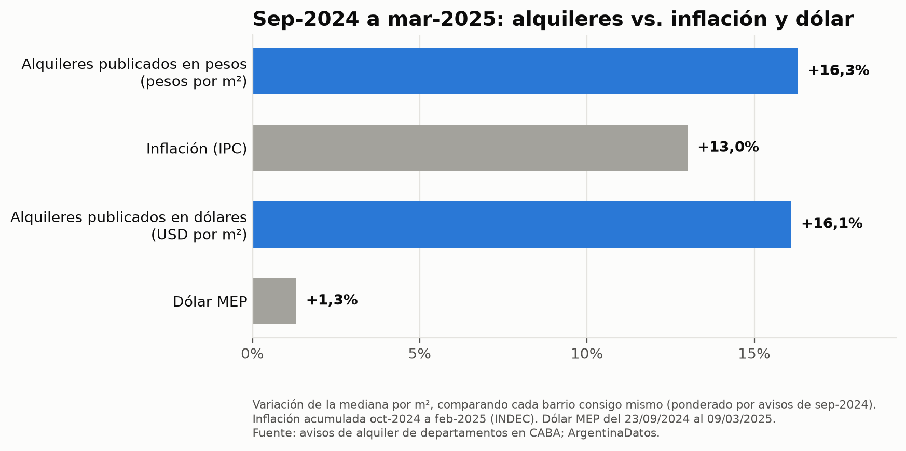
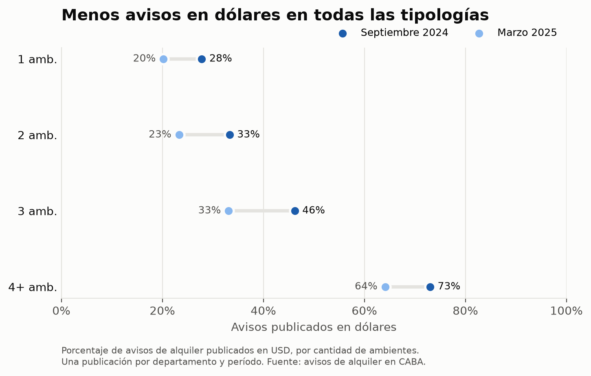

# Radar inmobiliario CABA

Análisis de **29.038 departamentos en alquiler** publicados en Zonaprop en la Ciudad de Buenos Aires entre septiembre de 2024 y julio de 2025: cuánto cuesta el m² en cada barrio, cómo influyen la superficie y los ambientes, y cómo evolucionaron los precios frente a la inflación y el dólar.



## Principales hallazgos

1. **Puerto Madero es un mercado aparte:** USD 22,7 por m², más del doble de la mediana de la ciudad (USD 10,2). El resto del corredor norte (Palermo, Núñez, Belgrano, Retiro y Recoleta) son los únicos otros barrios por encima de la mediana.
2. **Con el mismo presupuesto, el espacio cambia un 34% según el barrio.** Con USD 450 a 550 por mes se consiguen 59 m² en Balvanera o San Cristóbal y 44 m² en Palermo.
3. **Los departamentos grandes no son más caros por m² por ser grandes, sino por estar en barrios caros.** Dentro de un mismo barrio, en 9 de 14 barrios el m² de un 4 ambientes es más barato que el de un 2 ambientes.
4. **Entre sep-2024 y mar-2025 los alquileres le ganaron a la inflación y se encarecieron en dólares.** Los avisos en pesos subieron 16,3% por m² (inflación: 13,0%). Los avisos en dólares subieron 16,1% por m², con un dólar MEP que subió apenas 1,3%.
5. **El mercado se pesificó:** los avisos publicados en USD bajaron del 39% al 31% del total, en todas las tipologías.

## Preguntas y resultados

El análisis completo, con tablas y conclusiones, está en [`notebooks/02_analisis.ipynb`](notebooks/02_analisis.ipynb).

### 1. ¿Qué barrios tienen el precio más alto por m²?

Ver el gráfico de arriba. Fuera de los extremos, las diferencias son chicas: más de 30 barrios están entre USD 7,5 y 10 por m².

### 2. ¿Cómo influye la cantidad de ambientes en el precio?

El alquiler crece más rápido que la cantidad de ambientes: un 4 ambientes cuesta casi 3 veces lo que un 2 ambientes, porque tiene 2,6 veces más superficie.



A primera vista, el m² de los departamentos grandes parece más caro. Pero el 88% de los departamentos de 5+ ambientes está en el corredor norte, contra el 52% de los monoambientes. Al comparar **dentro de cada barrio**, el efecto se invierte en la mayoría de ellos:



### 3. ¿Qué relación hay entre superficie y precio?

Dentro de un mismo barrio el precio es proporcional a la superficie: la elasticidad precio-superficie es 1,01, o sea que un departamento 10% más grande cuesta un 10% más. El USD/m² tiene forma de U:
- **menos de 30 m²:** se paga un 12% más por m², porque los costos fijos (cocina, baño) se reparten en poca superficie
- **de 30 a 100 m²:** el m² se mantiene estable
- **más de 100 m²:** sube, por el segmento premium



### 4. ¿Qué barrios ofrecen la mejor relación precio/superficie?



### 5. ¿Cómo evolucionaron los precios?





## Datos

- **Fuente:** avisos de alquiler de departamentos en CABA publicados en [Zonaprop](https://www.zonaprop.com.ar), obtenidos por scraping. Dataset público en Kaggle: [Property prices in CABA - Zonaprop data](https://www.kaggle.com/datasets/martinbasualdo/property-prices-in-caba-zonaprop-data) (autor: martinbasualdo), publicado bajo licencia MIT.
- **Período:** 5 relevamientos (23, 24 y 29 de septiembre de 2024, 9 de marzo de 2025 y 12 de julio de 2025).
- **Datos externos:** cotización del dólar y la inflación mensual del INDEC, ambas obtenidas de [ArgentinaDatos](https://argentinadatos.com).

### Limpieza

El dataset original tiene 57.343 publicaciones. Cada filtro está documentado y se puede reproducir:

| Paso | Eliminados | Quedan |
|---|---:|---:|
| Dataset original | | 57.343 |
| Sin precio publicado ("Consultar precio") | 152 | 57.191 |
| Posible publicación de venta | 60 | 57.131 |
| Alquiler temporario | 3.678 | 53.453 |
| Precio fuera de USD 100 a 15.000 | 323 | 53.130 |
| Sin superficie informada | 339 | 52.791 |
| Superficie fuera de 15 a 1.000 m² | 103 | 52.688 |
| Más de 10 ambientes | 24 | 52.664 |
| USD/m² fuera de 2 a 100 | 27 | 52.637 |
| Barrio no identificado | 19 | **52.618 (91,8%)** |

Un mismo departamento puede aparecer en varios relevamientos. El dataset limpio tiene **29.038 departamentos únicos**.

## Metodología

- **Moneda común:** el 40% de los avisos está en dólares y el 60% en pesos. Los precios en pesos se convirtieron a USD con el **dólar MEP del día del relevamiento**. No se usó el oficial porque en 2024 la brecha cambiaria era del 26%, y los alquileres en dólares se pagan con dólares de mercado.
- **Una fila por departamento:** para comparar barrios se usa solo la publicación más reciente de cada aviso. Así, los avisos que estuvieron publicados más tiempo no pesan más.
- **Mediana en lugar de promedio**, porque la distribución de precios es asimétrica. Los rankings incluyen solo barrios con al menos 30 departamentos.
- **Barrios oficiales:** las zonas que usa el portal (Palermo Soho, Barrio Norte, Once, etc.) se normalizaron a los 48 barrios oficiales de CABA y sus 15 comunas.
- **Evolución con composición fija:** cada relevamiento tiene una mezcla distinta de barrios, así que comparar la mediana general de cada fecha da resultados engañosos. Por eso se compara cada barrio consigo mismo y después se ponderan los barrios con los mismos pesos.
- **Se descartó comparar el mismo aviso en dos fechas:** los avisos que siguen publicados meses después son los que no se alquilaron (sesgo de supervivencia). Más de la mitad no había cambiado su precio en 6 meses, con 13% de inflación.
- **Validación del criterio de temporarios:** el primer filtro marcaba el 15% del dataset. Al revisarlo, casi 4.800 eran falsos positivos por la expresión "comedor diario". El criterio se corrigió y se validó con una muestra manual ([detalle](notebooks/01_exploracion.ipynb)).

## Limitaciones

- Son **precios publicados**, no precios de cierre. Además, el dataset representa a un solo portal.
- Hay solo **3 momentos en el tiempo**, así que no se puede ver la evolución mes a mes. El relevamiento de julio de 2025 es parcial (2.145 avisos), por lo que sus resultados son preliminares.
- La antigüedad, los amenities o el estado del departamento no están disponibles de forma estructurada, así que no se controlan en las comparaciones.
- Los barrios con menos de 30 departamentos quedan fuera de los rankings: Agronomía, Nueva Pompeya, Parque Avellaneda, Versalles, Villa Real, Villa Riachuelo, Villa Soldati y Vélez Sársfield.

## Estructura del proyecto

```
├── data/
│   ├── raw/              # dataset original (no incluido en el repo)
│   ├── processed/        # dataset limpio (se genera con src/cleaning.py)
│   └── external/         # tipo de cambio e inflación
├── notebooks/
│   ├── 01_exploracion.ipynb   # exploración y decisiones de limpieza
│   └── 02_analisis.ipynb      # análisis y conclusiones
├── reports/figures/      # gráficos
└── src/
    ├── cleaning.py       # pipeline de limpieza
    ├── analysis.py       # funciones de análisis
    ├── charts.py         # gráficos
    └── tipo_cambio.py    # descarga de dólar e inflación
```

## Cómo reproducirlo

Requiere Python 3.12 o superior

```bash
git clone https://github.com/magaliorellana01/radar-inmobiliario-caba.git
cd radar-inmobiliario-caba
python -m venv .venv
.venv\Scripts\activate          # Windows  (Linux/Mac: source .venv/bin/activate)
pip install -r requirements.txt
```

1. Descargar el dataset de [Kaggle](https://www.kaggle.com/datasets/martinbasualdo/property-prices-in-caba-zonaprop-data) (archivo de alquiler de departamentos) y ubicarlo en `data/raw/alquiler_departamentos_consolidado.pkl`.
2. Generar el dataset limpio: `python -m src.cleaning`
3. Abrir `notebooks/02_analisis.ipynb` y ejecutar todas las celdas.

## Próximos pasos

- Dashboard interactivo en Streamlit para filtrar por barrio, ambientes y presupuesto.
- Relevamientos periódicos propios, para seguir la evolución mes a mes.
- Extraer amenities, cochera y antigüedad de las descripciones, para controlar por esas variables.

## Tecnologías

Python · pandas · NumPy · Matplotlib · Jupyter
